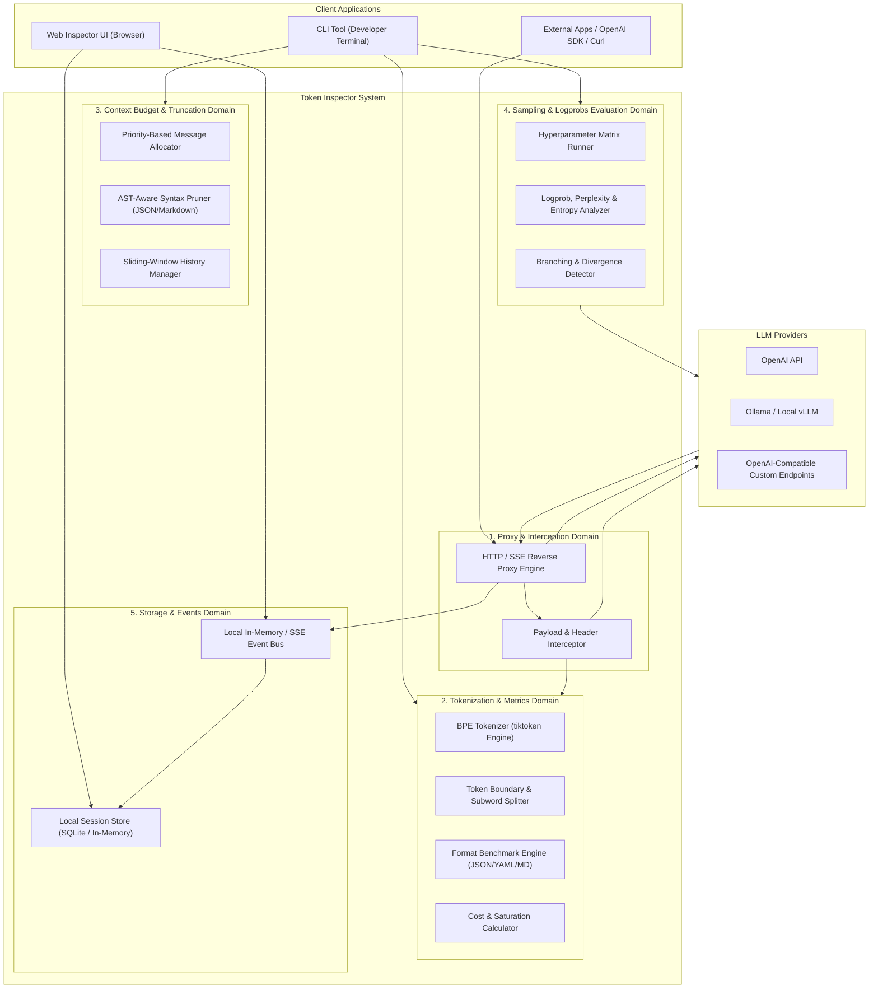

# Feature Plan: Token Inspector

**Feature Name**: `token-inspector`  
**High-Level Domain**: `Developer Tooling / LLM Infrastructure`  
**Status**: `Draft / Ready for Review`  
**Created Date**: 2026-11-16  

---

## 1. Executive Summary & Problem Scope

### 1.1 Problem Statement
When developing LLM-backed applications (RAG pipelines, autonomous agents, structured output extractors, and conversational interfaces), developers routinely operate under **token blindness**:
- **Format Inefficiency**: Developers often default to verbose data formats like multi-line indented JSON with repeated long keys, unaware of how byte-pair encoding (BPE) breaks structural delimiters into redundant tokens, inflating costs and latency by 30% to 150% compared to YAML, Markdown, or compact schemas.
- **Context Window Overflow & Naive Truncation**: When prompt context approaches window limits (e.g., 8k, 32k, or 128k tokens), naive string clipping cuts payloads mid-token or mid-JSON-object, causing unrecoverable parsing errors, broken syntax, or loss of critical system instructions.
- **Stochastic Sampling Ambiguity**: Tuning sampling hyperparameters (`temperature`, `top_p`) is largely done via guesswork. Developers lack visibility into token-level log probabilities (`logprobs`), making it difficult to pinpoint where model confidence collapses and where hallucinations or topic divergence begin.
- **Lack of Pre-Flight Transparency**: Most observability platforms (e.g., LangSmith, Helicone) inspect requests *after* they are sent to the provider, incurring real dollar costs and latency even for broken or bloated prompts.

### 1.2 Proposed Solution
`token-inspector` is a high-performance developer CLI tool and lightweight local web inspector that functions as a transparent pre-flight proxy and prompt analysis suite. It intercepts, visualizes, and optimizes LLM requests *before* and *as* they are dispatched:
1. **Transparent HTTP Reverse Proxy**: Sits between client applications (OpenAI SDK, LangChain, LlamaIndex, curl) and LLM providers (OpenAI, local Ollama, vLLM), analyzing tokens, cost, and context saturation in real time.
2. **Token Boundary Visualizer**: Renders alternating color-coded token boundaries in both terminal (ANSI) and Web UI, exposing subword fragmentation, whitespace inefficiencies, and format cost differentials (JSON vs. YAML vs. Markdown vs. raw code).
3. **Context Budget Manager**: Provides a priority-based, syntax-aware truncation engine that dynamically fits prompts within strict token ceilings while preserving structural integrity (valid JSON / Markdown) and protecting critical system instructions.
4. **Sampling & Logprobs Comparator**: Executes automated prompt matrices across temperature and `top_p` values, analyzing token logprobs and perplexity scores to map confidence decay and detect early hallucination branching.

---

## 2. Target Users & Beneficiaries

| Persona | Primary Needs & Pain Points | Value Delivered |
| :--- | :--- | :--- |
| **LLM Application Engineer** | Developing agents, tool-calling pipelines, and chat assistants; frequently hits token limits or experiences malformed JSON outputs. | Intercepts requests locally via transparent proxy; inspects exact token counts and costs pre-flight; prevents context overflows. |
| **Prompt Engineer / AI Ops** | Optimizing prompts for latency, cost, and context compactness across different prompt architectures. | Side-by-side format benchmark visualizer showing token fragmentation across JSON, YAML, and Markdown; highlights repetitive whitespace and token bloat. |
| **AI QA & Evaluation Researcher** | Investigating model hallucinations, stability under varying sampling parameters, and output divergence. | Automated sampling comparator testing temperature/`top_p` matrices; visual logprob heatmaps displaying model confidence and divergence points. |
| **Local LLM & Self-Hosted Operator** | Running models on Ollama/vLLM with constrained VRAM contexts (4k/8k). | Dynamic budget sliding window that trims conversation history without breaking structured message formatting. |

---

## 3. Explicit Goals & Non-Goals

### 3.1 Explicit Goals
- **G-1: Transparent Reverse Proxy Mode**: Provide an OpenAI-compatible HTTP reverse proxy (`/v1/chat/completions`, `/v1/models`, etc.) that captures request payloads, computes exact BPE token counts and estimated costs pre-flight, streams responses with zero latency penalty, and logs token-level metrics.
- **G-2: Multi-Model Tokenization Engine**: Support fast local BPE tokenization using `tiktoken` (covering `cl100k_base` for GPT-4/GPT-3.5, `o200k_base` for GPT-4o, `p50k_base`, and extensible mappings for custom/open models).
- **G-3: Token Boundary Visualizer**: Implement dual-surface visualization (CLI terminal with ANSI 256/Truecolor and Web UI with interactive hover cards) color-coding individual tokens, displaying token IDs, byte lengths, whitespace tokens, and subword fragments.
- **G-4: Format Efficiency Benchmarking**: Quantify token inflation between structural formats (JSON indented vs. JSON minified vs. YAML vs. Markdown tables vs. plain text) for equivalent data payloads.
- **G-5: Syntax-Aware Context Budget Manager**: Implement priority-based truncation (System Rules > User Query > Few-Shot Examples > Conversation History) that strictly respects token ceilings and guarantees structural validity (no truncated unclosed JSON strings, brackets, or Markdown codeblocks).
- **G-6: Sampling & Logprobs Matrix Comparator**: Run prompt permutations across temperature (e.g., 0.0, 0.7, 1.2) and `top_p` (e.g., 0.5, 0.9, 1.0), inspect provider logprobs, compute token perplexity/entropy, and highlight branching divergence points.
- **G-7: Lightweight Web Inspector Dashboard**: Deliver a local web dashboard displaying real-time proxy traffic, interactive token viewers, context window saturation gauges, and logprob confidence heatmaps.
- **G-8: Fast Developer CLI**: Offer dedicated CLI subcommands (`inspect`, `benchmark`, `budget`, `compare`, `proxy`) for terminal-first developer workflows and CI scripting.

### 3.2 Non-Goals (What We Will NOT Build)
- **NG-1: Not an Enterprise Production Gateway**: Not a replacement for enterprise API gateways (e.g., Kong, LiteLLM proxy in multi-cluster Kubernetes, Envoy, Cloudflare AI Gateway). We do not implement multi-tenant billing, team RBAC, or distributed caching.
- **NG-2: Not an LLM Training / Fine-Tuning Platform**: We do not train, fine-tune, or quantize models.
- **NG-3: No Proprietary Cloud Telemetry**: Zero external telemetry or phone-home tracking; operates 100% locally on the developer's machine with local persistence (SQLite / in-memory).
- **NG-4: No Closed Non-Tokenizable Model Emulation**: Models lacking public tokenizers or BPE vocabularies will use character-based heuristics with clear disclaimer flags, not reverse-engineered proprietary black boxes.
- **NG-5: No Heavy Distributed Orchestration**: Does not require Docker, Redis, or external databases to run; packaged as a single lightweight CLI and web service.

---

## 4. User Stories & Acceptance Criteria

### User Story 1: Transparent Reverse Proxy Mode
> **As an** LLM application developer,  
> **I want** to point my existing OpenAI client SDK (`base_url="http://localhost:8080/v1"`) to the token inspector proxy,  
> **So that** I can inspect token counts, costs, and context saturation in real time without modifying my application logic.

#### Acceptance Criteria (Given/When/Then):
1. **AC-1.1: Transparent Interception & Forwarding**
   - **Given** the proxy is running on `http://127.0.0.1:8080` and configured with target upstream `https://api.openai.com`,
   - **When** a client sends a `POST /v1/chat/completions` request with messages payload,
   - **Then** the proxy forwards the request with headers preserved, captures the request body, and returns the upstream provider's response with identical HTTP status and headers.
2. **AC-1.2: Streaming Pass-Through with Zero Interruption**
   - **Given** a chat completion request with `"stream": true`,
   - **When** the upstream provider yields Server-Sent Events (SSE) chunks,
   - **Then** the proxy pipes each SSE chunk immediately to the client without buffering latency, while accumulating the generated tokens in the background for post-flight inspection.
3. **AC-1.3: Pre-Flight Token & Cost Calculation**
   - **Given** an intercepted chat completion payload containing system and user messages,
   - **When** the proxy receives the payload,
   - **Then** it calculates exact prompt token count using `tiktoken` (accounting for message wrapper formatting tokens) and estimates dollar cost based on model pricing metadata before upstream dispatch.
4. **AC-1.4: Proxy Inspection Logs & Inspection Headers**
   - **Given** the proxy successfully processes an interaction,
   - **When** the client receives the response headers,
   - **Then** optional debug headers (`X-Token-Inspector-Prompt-Tokens`, `X-Token-Inspector-Cost-USD`, `X-Token-Inspector-Saturation-Pct`) are injected if configured.

---

### User Story 2: Terminal CLI Token Inspection & Analysis
> **As a** developer working in a terminal,  
> **I want** to run `token-inspector inspect` on raw text, files, or stdin,  
> **So that** I can immediately see the token count, subword boundaries, token IDs, and context saturation in my terminal.

#### Acceptance Criteria (Given/When/Then):
1. **AC-2.1: Terminal ANSI Token Boundary Visualization**
   - **Given** a prompt string or file input passed to `token-inspector inspect "<text>"`,
   - **When** the command executes,
   - **Then** it outputs the text with alternating background colors highlighting every distinct token boundary, followed by a summary table of total tokens, unique tokens, characters, and byte ratio.
2. **AC-2.2: Multi-Model Tokenizer Selection**
   - **Given** the CLI command with `--model gpt-4o` or `--tokenizer cl100k_base`,
   - **When** tokenization is performed,
   - **Then** the correct BPE encoding table is applied and verified against known reference token counts.
3. **AC-2.3: Context Window Saturation Warning**
   - **Given** a specified target context window limit `--context-window 8192`,
   - **When** the input token count exceeds 80% or 100% of the limit,
   - **Then** the CLI displays a visual progress bar and issues color-coded saturation warnings (Yellow for >80%, Red for >100% overflow).

---

### User Story 3: Lightweight Web Inspector UI
> **As a** full-stack developer or prompt engineer,  
> **I want** to open a local browser dashboard (`token-inspector ui`),  
> **So that** I can interactively inspect real-time intercepted proxy requests, explore token hover cards, and test truncation budgets.

#### Acceptance Criteria (Given/When/Then):
1. **AC-3.1: Live Request Stream via Web UI**
   - **Given** the Web Inspector is open in a modern browser and the proxy receives an LLM call,
   - **When** the request completes or streams,
   - **Then** the dashboard auto-updates in real time (via SSE/WebSocket) displaying the new request in the session feed with status, token count, latency, and model name.
2. **AC-3.2: Interactive Token Boundary Highlighting & Details**
   - **Given** a selected request in the Web UI,
   - **When** the user inspects the prompt or completion message,
   - **Then** each token is rendered in distinct contrasting badge chips; hovering over a chip displays a popover with Token ID, raw text, byte representation, and logprob (if available).
3. **AC-3.3: Context Saturation Gauge & Cost Breakdown**
   - **Given** an inspected prompt,
   - **When** viewing the metrics panel,
   - **Then** the UI displays an intuitive radial or linear gauge showing percentage of context window consumed and estimated input/output costs in USD.

---

### User Story 4: Token Boundary Visualizer & Format Inflation Benchmarking
> **As a** prompt engineer,  
> **I want** to compare identical structured datasets formatted in JSON, YAML, Markdown, and CSV,  
> **So that** I can identify the most token-efficient serialization format and eliminate whitespace bloat.

#### Acceptance Criteria (Given/When/Then):
1. **AC-4.1: Side-by-Side Format Tokenizer Comparison**
   - **Given** a structured data object provided via CLI `token-inspector benchmark --data input.json`,
   - **When** the benchmark runs,
   - **Then** it renders a side-by-side comparison matrix showing token count, character count, and token-to-character ratio for:
     1. Indented JSON (2 spaces)
     2. Minified JSON
     3. YAML
     4. Markdown Table / Key-Value
2. **AC-4.2: Repeated Key Bloat Detection**
   - **Given** an array of structured JSON objects with identical schemas (e.g., list of 50 users with `"first_name"`, `"email"`),
   - **When** analyzed by the visualizer,
   - **Then** the tool highlights repeated structural keys and calculates the exact token overhead percentage attributable to formatting vs. data payload.
3. **AC-4.3: Whitespace & Special Character Fragmentation Breakdown**
   - **Given** text with indentation, leading spaces, newlines, or Unicode emojis,
   - **When** visualized,
   - **Then** the tool flags subword anomalies (e.g., multiple spaces splitting into separate single-space tokens vs. tab characters) and offers optimization suggestions.

---

### User Story 5: Context Budget Manager & Syntax-Aware Truncation
> **As an** application engineer integrating RAG documents and chat history into a strict context budget,  
> **I want** to apply a priority-based, syntax-aware truncation strategy,  
> **So that** my prompt fits within the token limit without breaking JSON structures or losing vital instructions.

#### Acceptance Criteria (Given/When/Then):
1. **AC-5.1: Priority-Based Token Budget Allocation**
   - **Given** a prompt payload consisting of System Instructions (Priority 1), Current User Query (Priority 2), Few-Shot Examples (Priority 3), and Conversation History (Priority 4), with a token budget ceiling of 4096 tokens,
   - **When** total tokens exceed 4096,
   - **Then** the engine preserves Priority 1 and Priority 2 completely, truncates Priority 4 using a sliding window (oldest messages dropped first), and scales Priority 3 examples only if necessary to meet the ceiling.
2. **AC-5.2: Syntax-Aware Structural Truncation (JSON Safety)**
   - **Given** a JSON array or object payload in the context that must be truncated to satisfy a token budget,
   - **When** the budget manager truncates the data,
   - **Then** it prunes entire elements or nodes from the AST and produces syntactically valid JSON (validated with `json.loads`), never slicing strings mid-token or leaving unclosed brackets/braces.
3. **AC-5.3: Markdown & Code Block Closure Protection**
   - **Given** a Markdown document containing fenced code blocks (```) that is truncated mid-document,
   - **When** the budget manager outputs the truncated text,
   - **Then** it automatically inserts closing fences (```) and truncation markers (`[... truncated for context budget ...]`) so downstream markdown renderers do not corrupt.
4. **AC-5.4: Dry-Run CLI & API Truncation Modes**
   - **Given** CLI command `token-inspector budget --max-tokens 2048 --file prompt.json --strategy priority`,
   - **When** executed,
   - **Then** it outputs the truncated result, the number of tokens saved, and a diff summary of which messages or nodes were pruned.

---

### User Story 6: Sampling & Logprobs Matrix Comparator
> **As an** AI researcher or QA engineer,  
> **I want** to run a prompt through a matrix of temperature (0.0 vs. 0.7 vs. 1.2) and `top_p` values with logprobs enabled,  
> **So that** I can inspect token-level confidence scores, measure perplexity, and visually see where model outputs diverge and hallucinations start.

#### Acceptance Criteria (Given/When/Then):
1. **AC-6.1: Matrix Execution Across Hyperparameters**
   - **Given** a prompt and a test matrix definition (e.g., `temperatures: [0.0, 0.7]`, `top_p: [0.9, 1.0]`, `trials: 3`),
   - **When** running `token-inspector compare --prompt "..." --matrix config.yaml`,
   - **Then** the tool dispatches requests with `"logprobs": true` and `"top_logprobs": 5`, recording each output sequence and token probabilities.
2. **AC-6.2: Token Confidence & Perplexity Heatmap**
   - **Given** output tokens and their corresponding logprobs (`ln(P)`),
   - **When** rendered in the Web UI or CLI,
   - **Then** tokens are color-coded on a gradient:
     - High confidence ($P > 90\%$, Green)
     - Moderate confidence ($50\% \le P \le 90\%$, Yellow)
     - Low confidence / High uncertainty ($P < 50\%$, Red)
   - and the overall sequence perplexity ($e^{-\frac{1}{N}\sum \ln P}$) is displayed.
3. **AC-6.3: Divergence Point & Branching Detection**
   - **Given** multiple completions of the same prompt across different sampling parameters,
   - **When** compared by the tool,
   - **Then** it computes the exact token index where the first semantic branch occurs, displays the alternative candidate tokens with their respective probabilities, and highlights how temperature variance triggered the branching.

---

## 5. Functional Domain Classification



### Domain Breakdown:
1. **`Proxy & Interception Domain`**: Handles transparent HTTP listening, request routing, header management, non-blocking SSE streaming pass-through, and upstream dispatch.
2. **`Tokenization & Metrics Domain`**: Houses `tiktoken` BPE encodings, token boundary mapping, byte offsets, format serialization benchmark calculations, and dollar cost calculators.
3. **`Context Budget & Truncation Domain`**: Houses priority algorithms, syntax-preserving AST truncators for JSON and Markdown, sliding-window conversation history managers, and token ceiling enforcement.
4. **`Sampling & Logprobs Evaluation Domain`**: Manages matrix execution, logprob extraction, perplexity calculation, uncertainty classification, and multi-run token sequence alignment and divergence detection.
5. **`Storage & Events Domain`**: Manages ephemeral session state, request history, and real-time pub/sub event broadcasting to the Web UI via SSE.
6. **`Presentation Domain (CLI & Web UI)`**: ANSI 256/Truecolor terminal rendering with rich tables, plus the responsive Web Inspector UI dashboard.

---

## 6. Feasibility & Risk Assessment

| Risk Area | Severity | Likelihood | Impact | Mitigation Strategy |
| :--- | :--- | :--- | :--- | :--- |
| **Streaming Latency Overhead in Proxy Mode** | Medium | Medium | Intercepting chunks could introduce jitter or buffering delay into user-facing streaming responses. | **Zero-Copy Streaming**: Stream SSE chunks immediately to the client socket without awaiting tokenization; perform token accumulation and metric aggregation asynchronously in a background task. |
| **Chat Template & Special Token Mismatch** | Medium | Low | Counting only raw message strings without OpenAI chat format overhead (e.g., `<\|im_start\|>`, role markers) results in undercounting by 3–4 tokens per message. | **Standardized Chat Token Counting**: Implement exact OpenAI chat format formulas (e.g. 3 overhead tokens per message, 3 tokens per reply primer) matching the official OpenAI cookbook. |
| **Syntax Corruption during Truncation** | High | Medium | Truncating a long JSON context payload mid-string produces broken JSON, failing downstream function/tool calls. | **Structural AST-Level Pruning**: Parse into an abstract syntax tree (AST) or structured dictionary first; prune at element/field boundaries and re-serialize, guaranteeing valid syntax; fall back to conservative markdown code-block wrapping. |
| **Upstream Rate Limiting on Matrix Comparison** | Low | Medium | Running high-concurrency sampling matrices with logprobs could trigger HTTP 429 rate limits on live provider accounts. | **Adaptive Throttling & Mock Replay**: Implement configurable concurrency limits, exponential backoff, and an offline mock runner for local development and testing. |
| **Token Visualizer Terminal Compatibility** | Low | Low | ANSI background colors may render unpredictably on legacy terminals lacking 256-color or Truecolor support. | **Adaptive Terminal Styling**: Detect terminal capabilities using `rich`; degrade gracefully to high-contrast monochrome delimiters (`[| token |]`) if color depth is insufficient. |

---

## 7. Success Metrics & Key Performance Indicators (KPIs)

- **Tokenization Accuracy**: 100% parity with OpenAI `tiktoken` official reference counts across `cl100k_base` and `o200k_base` benchmarks.
- **Proxy Overhead Latency**: Less than 5ms added latency for non-streaming calls; <1ms chunk pass-through overhead on streaming SSE.
- **Syntax Preservation Rate**: 100% of truncated JSON payloads must parse cleanly with standard JSON parsers (`json.loads`).
- **Format Savings Visibility**: Clear measurement showing typical 25–40% token reductions when migrating from verbose JSON to compact YAML/Markdown formats.
- **Test Coverage**: >85% automated test coverage across unit, integration, and CLI/proxy E2E tests following the Testing Trophy guidelines.

---

## 8. Next Steps & Autonomous Chaining

1. **Stage 2: Plan Review (`plan-reviewer`)**: Subject this plan to adversarial review (`features/token-inspector/plan-review.md`) to challenge assumptions, edge cases, and scope boundaries.
2. **Stage 4: Architecture & Technical Specification (`architect`)**: Specify data schemas, API contracts, project layout, and atomic TDD task breakdown in `features/token-inspector/spec.md`.
3. **Stage 5: Spec Review (`spec-reviewer`)**: Adversarially review architectural readiness.
4. **Stage 5.5: Human Architecture Gate**: Present final architecture to the human lead for sign-off.
5. **Stage 6: Modern TDD Implementation (`developer`)**: Implement and incrementally commit tasks with verified green tests.
