# Technical Specification: Token Inspector

**Feature Name**: `token-inspector`  
**High-Level Domain**: `Developer Tooling / LLM Infrastructure & Pre-flight Observability`  
**Status**: `Approved by Human Lead (2026-11-16) / In Modern TDD Implementation`  
**Architect**: `System Architect & Spec Definer`  
**Date**: 2026-11-16  
**Reference Documents**:
- Plan: [`features/token-inspector/plan.md`](file:///home/ggm/Work/tiktoken/features/token-inspector/plan.md)
- Plan Review: [`features/token-inspector/plan-review.md`](file:///home/ggm/Work/tiktoken/features/token-inspector/plan-review.md)
- UI/UX Design: [`features/token-inspector/design.md`](file:///home/ggm/Work/tiktoken/features/token-inspector/design.md)

---

## 1. Architectural Overview & System Design

`token-inspector` is a high-performance local developer CLI tool and embedded pre-flight observability suite for Large Language Model (LLM) applications. It eliminates developer "token blindness" by providing:
1. A transparent, non-blocking HTTP/SSE reverse proxy intercepting OpenAI-compatible completions.
2. A fast local BPE tokenization and boundary visualizer engine powered by `tiktoken`.
3. A format serialization benchmark analyzer (JSON vs. YAML vs. Markdown vs. Raw Plaintext).
4. A syntax-preserving, AST-aware context budget manager that truncates prompts while guaranteeing valid JSON and repaired Markdown codeblocks.
5. An automated sampling matrix runner evaluating token logprobs, perplexity, and semantic branching divergence.
6. A zero-CDN, offline-first embedded Web Inspector dashboard and developer-native terminal CLI.

### 1.1 High-Level Architecture Diagram

```mermaid
flowchart TD
    subgraph Client_Layer["Client Applications"]
        CLI["Developer Terminal CLI<br/>(token-inspector inspect / benchmark / budget / proxy)"]
        SDK["LLM SDKs / Applications<br/>(OpenAI SDK, LangChain, LlamaIndex, curl)"]
        Browser["Embedded Web Inspector<br/>(Zero-CDN Single-Binary UI)"]
    end

    subgraph Token_Inspector["Token Inspector Core Application (src/token_inspector)"]
        subgraph Proxy_Domain["1. Proxy & Interception Domain"]
            ProxyServer["ReverseProxyServer<br/>(proxy/reverse_proxy_server.py)"]
            Interceptor["RequestInterceptor<br/>(proxy/request_interceptor.py)"]
            Streamer["StreamingForwarder<br/>(proxy/streaming_forwarder.py)"]
            DisconnectHandler["DisconnectHandler<br/>(proxy/disconnect_handler.py)"]
        end

        subgraph Tokenizer_Domain["2. Tokenization & Metrics Domain"]
            BPE["BPEEncoder<br/>(tokenizer/bpe_encoder.py)"]
            Registry["ModelRegistry<br/>(tokenizer/model_registry.py)"]
            ChatFormat["ChatFormatter<br/>(tokenizer/chat_formatter.py)"]
            Multimodal["MultimodalEstimator<br/>(tokenizer/multimodal_estimator.py)"]
            CostCalc["CostEstimator<br/>(tokenizer/cost_estimator.py)"]
            FormatBench["FormatAnalyzer<br/>(tokenizer/format_analyzer.py)"]
            BoundaryVis["BoundaryVisualizer<br/>(tokenizer/boundary_visualizer.py)"]
        end

        subgraph Budget_Domain["3. Context Budget & Truncation Domain"]
            BudgetMgr["ContextBudgetManager<br/>(budget/context_budget_manager.py)"]
            PriorityAlloc["PriorityAllocator<br/>(budget/priority_allocator.py)"]
            JsonPruner["JsonAstPruner<br/>(budget/json_ast_pruner.py)"]
            MdRepair["MarkdownFenceRepairer<br/>(budget/markdown_fence_repairer.py)"]
            SlidingWindow["SlidingWindowPruner<br/>(budget/sliding_window_pruner.py)"]
        end

        subgraph Sampling_Domain["4. Sampling & Logprobs Domain"]
            MatrixRunner["MatrixRunner<br/>(sampling/matrix_runner.py)"]
            LogprobEval["LogprobEvaluator<br/>(sampling/logprob_evaluator.py)"]
            PerplexityCalc["PerplexityCalculator<br/>(sampling/perplexity_calculator.py)"]
            DivergenceDetect["DivergenceDetector<br/>(sampling/divergence_detector.py)"]
        end

        subgraph Storage_Domain["5. Storage & Events Domain"]
            RingBuffer["CircularEventBuffer<br/>(storage/circular_event_buffer.py)"]
            Store["InspectionStore<br/>(storage/inspection_store.py)"]
        end

        subgraph Web_Domain["6. Web UI & Delivery Domain"]
            WebServer["EmbeddedWebServer<br/>(web/embedded_server.py)"]
            SSEBroadcaster["SSEBroadcaster<br/>(web/sse_broadcaster.py)"]
            BundleProvider["StaticBundleProvider<br/>(web/static_bundle_provider.py)"]
        end
    end

    subgraph Upstream_Providers["Upstream LLM Providers"]
        OpenAIAPI["api.openai.com"]
        OllamaAPI["Local Ollama (localhost:11434)"]
        vLLMAPI["vLLM / Custom OpenAI Endpoint"]
    end

    SDK -->|HTTP / SSE Traffic| ProxyServer
    ProxyServer --> Interceptor
    Interceptor --> ChatFormat
    Interceptor --> BPE
    Interceptor --> CostCalc
    ProxyServer --> Streamer
    Streamer --> Upstream_Providers
    Streamer --> DisconnectHandler
    Streamer -->|Async Accumulation| RingBuffer
    RingBuffer --> Store
    RingBuffer --> SSEBroadcaster
    SSEBroadcaster -->|SSE /api/events| Browser

    Browser -->|HTTP REST / Static| WebServer
    WebServer --> BundleProvider
    WebServer --> Store

    CLI --> BPE
    CLI --> FormatBench
    CLI --> BudgetMgr
    CLI --> MatrixRunner
    BudgetMgr --> PriorityAlloc
    BudgetMgr --> JsonPruner
    BudgetMgr --> MdRepair
    BudgetMgr --> SlidingWindow

    MatrixRunner --> Upstream_Providers
    MatrixRunner --> LogprobEval
    LogprobEval --> PerplexityCalc
    MatrixRunner --> DivergenceDetect
```



---

## 2. Modularity & Pragmatic SOLID File Layout

In strict adherence to the **"One File per Functionality or Class"** architectural standard, every component is decoupled into its own dedicated module under `src/token_inspector/`. No grab-bag utility files (`utils.py`, `helpers.py`, `common.py`) are permitted.

```text
src/token_inspector/
├── __init__.py                                 # Package metadata and public exports
├── models/                                     # Typed Pydantic domain models & contracts
│   ├── __init__.py
│   ├── token_item.py                           # TokenItem dataclass & token boundary schema
│   ├── inspection_record.py                    # InspectionRecord schema (captured proxy request)
│   ├── budget_schemas.py                       # ContextBudgetRequest, TruncationResult, MessagePriority
│   ├── format_schemas.py                       # FormatBenchmarkResult, FormatComparisonMatrix, KeyBloatReport
│   ├── sampling_schemas.py                     # SamplingMatrixConfig, SamplingTrialResult, DivergencePoint
│   └── event_schemas.py                        # InspectorSSEEvent, EventFilter
├── tokenizer/                                  # Tokenization & metrics domain
│   ├── __init__.py
│   ├── bpe_encoder.py                          # BPEEncoder (tiktoken binding, encode/decode, token IDs)
│   ├── model_registry.py                       # ModelRegistry (maps model names to encodings and context ceilings)
│   ├── chat_formatter.py                       # ChatFormatter (OpenAI chat template overhead token calculation)
│   ├── multimodal_estimator.py                 # MultimodalEstimator (high/low detail image tile token math)
│   ├── cost_estimator.py                       # CostEstimator (model pricing calculator for input & output)
│   ├── format_analyzer.py                      # FormatAnalyzer (JSON/YAML/MD format benchmark & repeated keys)
│   └── boundary_visualizer.py                  # BoundaryVisualizer (ANSI Truecolor / 256 color terminal tokens)
├── budget/                                     # Context budget & syntax-aware truncation domain
│   ├── __init__.py
│   ├── context_budget_manager.py               # ContextBudgetManager (orchestrates priority allocation & pruning)
│   ├── priority_allocator.py                   # PriorityAllocator (allocates token quotas across message priorities)
│   ├── json_ast_pruner.py                      # JsonAstPruner (AST-aware JSON pruning ensuring valid JSON syntax)
│   ├── markdown_fence_repairer.py              # MarkdownFenceRepairer (auto-closes open ``` codeblocks on truncation)
│   └── sliding_window_pruner.py                # SlidingWindowPruner (FIFO conversation history sliding window)
├── sampling/                                   # Sampling matrix & logprob evaluation domain
│   ├── __init__.py
│   ├── matrix_runner.py                        # MatrixRunner (concurrent prompt matrix runner with backoff)
│   ├── logprob_evaluator.py                    # LogprobEvaluator (logprob to probability conversion, confidence tiers)
│   ├── perplexity_calculator.py                # PerplexityCalculator (sequence perplexity & entropy formulas)
│   └── divergence_detector.py                  # DivergenceDetector (token sequence alignment & semantic branching)
├── storage/                                    # Ephemeral storage & event buffering domain
│   ├── __init__.py
│   ├── circular_event_buffer.py                # CircularEventBuffer (bounded in-memory ring buffer for last N items)
│   └── inspection_store.py                     # InspectionStore (cursor-based pagination and request filtering)
├── proxy/                                      # Reverse proxy & interception domain
│   ├── __init__.py
│   ├── reverse_proxy_server.py                 # ReverseProxyServer (ASGI HTTP/SSE proxy application)
│   ├── request_interceptor.py                  # RequestInterceptor (pre-flight token calculation & header injection)
│   ├── streaming_forwarder.py                  # StreamingForwarder (zero-latency SSE streaming pass-through)
│   └── disconnect_handler.py                   # DisconnectHandler (client cancellation cleanup & upstream abort)
├── web/                                        # Embedded Web Inspector UI & server
│   ├── __init__.py
│   ├── embedded_server.py                      # EmbeddedWebServer (mounts static assets & REST/SSE routes)
│   ├── sse_broadcaster.py                      # SSEBroadcaster (pub/sub SSE stream distributor for web clients)
│   ├── static_bundle_provider.py               # StaticBundleProvider (reads embedded assets with ETag support)
│   └── static/                                 # Zero-CDN embedded web application assets
│       ├── index.html                          # Single-page shell with WCAG 2.1 AA semantic landmarks
│       ├── app.css                             # Dark mode design tokens, 6-hue cycling badges, meters
│       └── app.js                              # Vanilla ES module reactive UI, SSE client, virtualized chips
└── cli/                                        # Developer CLI interface domain
    ├── __init__.py
    ├── main.py                                 # Main CLI entrypoint (Typer/Click command group `token-inspector`)
    ├── inspect_command.py                      # Subcommand: inspect text/file with ANSI boundaries & token table
    ├── benchmark_command.py                    # Subcommand: benchmark format serialization efficiency
    ├── budget_command.py                       # Subcommand: budget simulation & syntax-aware dry-run truncation
    ├── compare_command.py                      # Subcommand: compare sampling matrix, perplexity & divergence tree
    └── proxy_command.py                        # Subcommand: run transparent reverse proxy & web inspector

tests/                                          # Strict external test hierarchy (Testing Trophy)
├── conftest.py                                 # Pytest fixtures, mock upstream server, test payloads
├── unit/                                       # Fast unit tests: pure logic, BPE math, AST pruning
│   ├── test_models.py                          # Tests token_item & inspection_record models
│   ├── test_bpe_encoder.py                     # Tests BPEEncoder tiktoken bindings
│   ├── test_model_registry.py                  # Tests ModelRegistry lookups and fallbacks
│   ├── test_chat_formatter.py                  # Tests ChatFormatter chat markup overhead parity
│   ├── test_multimodal_estimator.py            # Tests MultimodalEstimator tile calculation
│   ├── test_cost_estimator.py                  # Tests CostEstimator dollar calculations
│   ├── test_format_analyzer.py                 # Tests FormatAnalyzer format savings & key bloat
│   ├── test_boundary_visualizer.py             # Tests BoundaryVisualizer ANSI rendering
│   ├── test_budget_schemas.py                  # Tests budget & truncation schemas
│   ├── test_priority_allocator.py              # Tests PriorityAllocator quota assignment
│   ├── test_json_ast_pruner.py                 # Tests JsonAstPruner syntax validity guarantee
│   ├── test_markdown_fence_repairer.py         # Tests MarkdownFenceRepairer auto-closing fences
│   ├── test_sliding_window_pruner.py           # Tests SlidingWindowPruner FIFO turn dropping
│   ├── test_context_budget_manager.py          # Tests ContextBudgetManager orchestration & overflow
│   ├── test_sampling_schemas.py                # Tests sampling matrix schemas
│   ├── test_logprob_evaluator.py               # Tests LogprobEvaluator probability & tiers
│   ├── test_perplexity_calculator.py           # Tests PerplexityCalculator sequence formulas
│   ├── test_divergence_detector.py             # Tests DivergenceDetector sequence branching
│   ├── test_circular_event_buffer.py           # Tests CircularEventBuffer ring eviction
│   ├── test_inspection_store.py                # Tests InspectionStore cursor pagination
│   ├── test_static_bundle_provider.py          # Tests StaticBundleProvider ETags & MIME types
│   └── test_web_assets.py                      # Tests zero-CDN isolation & asset bundling
├── integration/                                # Integration tests (The Sweet Spot)
│   ├── test_matrix_runner.py                   # Tests concurrent sampling execution with mock LLM
│   ├── test_request_interceptor.py             # Tests pre-flight token math & debug headers
│   ├── test_streaming_sse_forwarder.py         # Tests zero-latency streaming SSE pass-through
│   ├── test_disconnect_handler.py              # Tests client abort & upstream cancellation
│   ├── test_reverse_proxy_interception.py      # Tests full ASGI proxy routing & interception
│   ├── test_sse_broadcaster.py                 # Tests Web SSE event broadcasting
│   └── test_web_api_routes.py                  # Tests Web Inspector REST & SSE endpoints
└── e2e/                                        # Critical end-to-end user journeys
    ├── test_cli_inspect.py                     # CLI inspect command E2E
    ├── test_cli_benchmark.py                   # CLI benchmark command E2E
    ├── test_cli_budget.py                      # CLI budget dry-run command E2E
    ├── test_cli_compare.py                     # CLI compare sampling matrix command E2E
    └── test_cli_proxy_e2e.py                   # Full OpenAI client SDK -> Proxy -> LLM E2E
```

### 2.1 Pragmatic SOLID Compliance Matrix

| Principle | Architectural Implementation | Concrete Benefit |
| :--- | :--- | :--- |
| **Single Responsibility (SRP)** | Every module has one discrete reason to change: `json_ast_pruner.py` only handles JSON AST manipulation; `streaming_forwarder.py` only handles non-blocking SSE chunk piping; `cost_estimator.py` only calculates token pricing. | Zero cross-domain leakage; changes to OpenAI pricing tables do not touch tokenization or proxy routing logic. |
| **Open/Closed (OCP)** | `ModelRegistry` permits registration of new models and tokenizer encodings via clean mapping dictionaries without modifying the core `BPEEncoder`. Truncation strategies implement a common protocol (`TruncationStrategy`). | Easily extendable to Anthropic, Llama 3, or Mistral tokenizers without rewriting existing pipelines. |
| **Liskov Substitution (LSP)** | All pruning strategies (`JsonAstPruner`, `SlidingWindowPruner`) conform to the base interface: accepting a payload and token ceiling, returning a `TruncationResult` with valid syntax guarantees. | `ContextBudgetManager` can interchange pruners seamlessly without conditional type branching. |
| **Interface Segregation (ISP)** | Client interfaces are small and targeted: `TokenStorageReader` provides read-only pagination, while `TokenStorageWriter` provides append operations. CLI commands consume only the domain services they invoke. | Prevents bloated god-objects or forced dependencies on unused database/proxy functionality. |
| **Dependency Inversion (DIP)** | `ReverseProxyServer` depends on abstract `EventBroadcaster` and `InspectionStorage` protocols, which are fulfilled by `SSEBroadcaster` and `InspectionStore`. | Unit and integration tests can inject memory stubs without launching background web sockets or servers. |
| **Pragmatism Clause** | Concrete classes are used directly where polymorphism is unnecessary (e.g. `PerplexityCalculator`, `MultimodalEstimator`). Speculative abstractions and factory layers are strictly forbidden. | Code remains straightforward, readable, and devoid of lasagna indirection. |

---

## 3. Data Models & Typed API Contracts

All data structures are defined using modern Python `pydantic` (v2) models with full type safety, runtime validation, and JSON schema exportability.

### 3.1 Core Data Models

#### 3.1.1 TokenItem (`src/token_inspector/models/token_item.py`)
```python
from pydantic import BaseModel, Field
from typing import Optional

class SubwordInfo(BaseModel):
    is_subword_continuation: bool = Field(..., description="True if token is part of a fragmented word")
    word_boundary_index: int = Field(..., description="Index of the word this token belongs to")

class TokenItem(BaseModel):
    index: int = Field(..., description="Sequential 0-based token index in sequence")
    token_id: int = Field(..., description="Numeric BPE token ID (e.g. 9906)")
    text: str = Field(..., description="Decoded UTF-8 token string")
    raw_bytes: str = Field(..., description="Hex representation of raw byte sequence (e.g. '0x20 0x6a')")
    byte_length: int = Field(..., description="Number of raw bytes in token")
    is_whitespace: bool = Field(..., description="True if token consists solely of whitespace characters")
    subword_info: SubwordInfo = Field(..., description="Subword fragmentation metadata")
    logprob: Optional[float] = Field(None, description="Natural log probability ln(P) if generation token")
    probability_pct: Optional[float] = Field(None, description="Derived probability P * 100")
```

#### 3.1.2 InspectionRecord (`src/token_inspector/models/inspection_record.py`)
```python
from pydantic import BaseModel, Field
from typing import List, Dict, Any, Optional
from datetime import datetime
from src.token_inspector.models.token_item import TokenItem

class RoleTokenBreakdown(BaseModel):
    role: str = Field(..., description="system | user | assistant | tool")
    token_count: int = Field(..., description="Total tokens in message")
    tokens: List[TokenItem] = Field(default_factory=list, description="Detailed token items")

class InspectionRecord(BaseModel):
    id: str = Field(..., description="Unique request identifier (e.g. req_89f2a)")
    timestamp: datetime = Field(..., description="ISO-8601 UTC timestamp of request")
    method: str = Field("POST", description="HTTP request method")
    path: str = Field("/v1/chat/completions", description="Intercepted request endpoint")
    model: str = Field(..., description="Requested model identifier (e.g. gpt-4o)")
    status_code: int = Field(200, description="HTTP response status code from upstream")
    duration_ms: float = Field(..., description="End-to-end request latency in milliseconds")
    ttfb_ms: Optional[float] = Field(None, description="Time to first byte in streaming mode")
    is_streaming: bool = Field(False, description="True if stream: true was requested")
    
    prompt_tokens: int = Field(..., description="Total prompt tokens calculated via BPE")
    completion_tokens: int = Field(0, description="Total completion tokens generated")
    total_tokens: int = Field(..., description="prompt_tokens + completion_tokens")
    context_ceiling: int = Field(..., description="Total model context window limit")
    saturation_pct: float = Field(..., description="Percentage of context window consumed (0-100+)")
    
    estimated_cost_usd: float = Field(..., description="Estimated cost based on model pricing")
    messages_breakdown: List[RoleTokenBreakdown] = Field(default_factory=list)
    completion_tokens_detail: List[TokenItem] = Field(default_factory=list)
    raw_request_headers: Dict[str, str] = Field(default_factory=dict)
    raw_response_headers: Dict[str, str] = Field(default_factory=dict)
```

#### 3.1.3 Context Budget & Truncation Models (`src/token_inspector/models/budget_schemas.py`)
```python
from pydantic import BaseModel, Field
from typing import List, Dict, Any, Optional
from enum import IntEnum

class PriorityTier(IntEnum):
    SYSTEM_RULES = 1      # Never prune
    USER_QUERY = 2        # Never prune unless monolithic overflow policy triggers
    FEW_SHOT = 3          # Prune if history is exhausted
    CHAT_HISTORY = 4      # Prune oldest first (sliding window)

class ContextMessage(BaseModel):
    role: str
    content: Any          # str or List[Dict[str, Any]] for multimodal
    priority: PriorityTier = PriorityTier.CHAT_HISTORY
    name: Optional[str] = None

class ContextBudgetRequest(BaseModel):
    messages: List[ContextMessage]
    max_tokens: int = Field(..., gt=0, description="Target token budget ceiling")
    model: str = Field("gpt-4o", description="Model name for tokenizer encoding")
    allow_user_truncation: bool = Field(False, description="Allow P2 truncation if query alone exceeds ceiling")
    ensure_json_syntax: bool = Field(True, description="Enforce valid JSON syntax on pruned data payloads")
    auto_close_markdown: bool = Field(True, description="Close open markdown fences on truncated text")

class TruncationDiff(BaseModel):
    original_tokens: int
    truncated_tokens: int
    tokens_saved: int
    pruned_message_indices: List[int]
    partially_pruned_details: Dict[str, Any] = Field(default_factory=dict)

class TruncationResult(BaseModel):
    messages: List[Dict[str, Any]]
    diff: TruncationDiff
    is_budget_satisfied: bool
    json_ast_validated: bool
    markdown_repaired: bool
```

#### 3.1.4 Format Benchmark Models (`src/token_inspector/models/format_schemas.py`)
```python
from pydantic import BaseModel, Field
from typing import List, Dict, Any

class FormatMetric(BaseModel):
    format_name: str = Field(..., description="json_indented | json_minified | yaml | markdown_table")
    token_count: int
    byte_count: int
    char_count: int
    token_to_byte_ratio: float
    token_savings_pct: float = Field(0.0, description="Percentage savings relative to baseline")
    cost_per_million_calls_usd: float

class KeyBloatItem(BaseModel):
    key_name: str
    occurrences: int
    tokens_per_key: int
    total_token_overhead: int
    overhead_percentage: float

class FormatBenchmarkResult(BaseModel):
    model: str
    baseline_format: str = "json_indented"
    formats: List[FormatMetric]
    winner_format: str
    key_bloat: List[KeyBloatItem]
    recommendation: str
```

#### 3.1.5 Sampling Matrix & Logprob Models (`src/token_inspector/models/sampling_schemas.py`)
```python
from pydantic import BaseModel, Field
from typing import List, Optional

class CandidateToken(BaseModel):
    token: str
    logprob: float
    probability_pct: float

class EvaluatedToken(BaseModel):
    index: int
    token: str
    logprob: float
    probability_pct: float
    confidence_tier: str = Field(..., description="high (>90%) | moderate (50-90%) | uncertain (<50%)")
    top_candidates: List[CandidateToken] = Field(default_factory=list)

class SamplingTrialResult(BaseModel):
    trial_id: str
    temperature: float
    top_p: float
    output_text: str
    tokens: List[EvaluatedToken]
    perplexity: float
    average_confidence_pct: float
    divergence_token_index: Optional[int] = None

class DivergencePoint(BaseModel):
    token_index: int
    baseline_token: str
    divergent_token: str
    divergence_reason: str
    candidate_tokens: List[CandidateToken]

class SamplingMatrixReport(BaseModel):
    prompt: str
    model: str
    trials: List[SamplingTrialResult]
    divergence_points: List[DivergencePoint]
```

#### 3.1.6 Server-Sent Event Payloads (`src/token_inspector/models/event_schemas.py`)
```python
from pydantic import BaseModel, Field
from typing import Literal, Dict, Any

class InspectorSSEEvent(BaseModel):
    event_type: Literal["request_captured", "stream_chunk", "stream_completed", "stream_aborted"]
    request_id: str
    payload: Dict[str, Any]
    timestamp: str
```

---

## 4. REST & SSE API Contracts

The embedded HTTP server exposes an OpenAI-compatible reverse proxy at the root (`/v1/...`) and the Token Inspector control plane at `/_inspector/...`.

### 4.1 Reverse Proxy Endpoints

#### `POST /v1/chat/completions`
- **Description**: Transparent reverse proxy pass-through to upstream provider (`api.openai.com` or local Ollama).
- **Request Headers**: Standard OpenAI headers (`Authorization: Bearer <key>`, `Content-Type: application/json`).
- **Injected Response Headers**:
  - `X-Token-Inspector-Prompt-Tokens: <int>`
  - `X-Token-Inspector-Cost-USD: <float>`
  - `X-Token-Inspector-Saturation-Pct: <float>`
  - `X-Token-Inspector-Request-ID: <str>`
- **Non-Streaming Behavior**: Forwards request upstream, awaits complete response, calculates output tokens, records inspection record in circular buffer, returns upstream response intact.
- **Streaming Behavior (`stream: true`)**: Establishes upstream SSE connection, pipes incoming chunks immediately to client with `<1ms` chunk delay, accumulates tokens in an async background task, writes final metrics upon completion.
- **Cancellation Handling**: If the client socket disconnects mid-stream, the proxy traps `asyncio.CancelledError`, immediately sends an abort signal to the upstream HTTP connection, logs the partial token count, and frees connection handles.

### 4.2 Inspector Control Plane Endpoints

#### `GET /_inspector`
- **Description**: Serves the single-page zero-CDN embedded Web Inspector UI (`index.html`).
- **Response**: `200 OK`, `Content-Type: text/html; charset=utf-8`, `Cache-Control: public, max-age=3600`.

#### `GET /_inspector/static/{filename}`
- **Description**: Serves pre-compiled CSS (`app.css`) and JavaScript (`app.js`).
- **Response Headers**: `Content-Type: text/css` or `application/javascript`, `ETag: "<hash>"`.

#### `GET /_inspector/api/events`
- **Description**: SSE stream broadcasting live proxy activity to connected Web Inspector browser tabs.
- **Protocol**: `text/event-stream`.
- **Event Names**:
  - `request_captured`: Emitted immediately upon pre-flight calculation.
  - `stream_completed`: Emitted when streaming response completes.
  - `stream_aborted`: Emitted when client cancels stream.
- **Keep-Alive**: Ping comment (`: ping\n\n`) every 15 seconds to prevent client timeout.

#### `GET /_inspector/api/history`
- **Description**: Cursor-based paginated inspection history.
- **Query Parameters**:
  - `cursor`: Optional request ID pagination marker.
  - `limit`: Integer (default 50, max 200).
  - `model`: Optional filter by model name.
- **Response**:
  ```json
  {
    "items": [ /* List of InspectionRecord */ ],
    "next_cursor": "req_89f2a",
    "has_more": true,
    "total_captured": 1420
  }
  ```

#### `POST /_inspector/api/budget/simulate`
- **Description**: Simulates priority-based and syntax-aware truncation against an arbitrary context payload.
- **Request Body**: `ContextBudgetRequest`
- **Response**: `TruncationResult`

#### `POST /_inspector/api/format/benchmark`
- **Description**: Runs format efficiency analysis on arbitrary JSON/data payload.
- **Request Body**: `{"data": Any, "model": "gpt-4o"}`
- **Response**: `FormatBenchmarkResult`

---

## 5. Platform-Specific Architectural Nuances

### 5.1 Web Platform Nuances (Embedded Dashboard)
- **Zero-CDN Single-Binary Distribution**:
  - Zero external calls to CDNs (`unpkg.com`, `cdnjs.cloudflare.com`) or Google Fonts. Operates in completely isolated/air-gapped networks.
  - Assets bundled in `src/token_inspector/web/static/` and served via Python package resources.
- **Performance Budget**:
  - Core Web Vitals targets: FCP < 600ms, LCP < 900ms, INP < 40ms, CLS = 0.00.
  - Single-page application size: `<140KB` uncompressed, `<40KB` gzipped.
- **Client State & Virtualization**:
  - Ultra-lightweight reactive micro-store without heavy framework overhead (Vanilla ES Modules + Web Components).
  - Virtualized rendering for token chip lists exceeding 1,000 tokens to ensure 60fps scrolling and eliminate DOM bloating.
- **Caching & Transport**:
  - Static assets served with `ETag` and `Cache-Control: stale-while-revalidate`.
  - Live transport uses native browser `EventSource` with auto-reconnection and exponential backoff (1s, 2s, 4s).
- **Web Security**:
  - Strict Content Security Policy (CSP): `default-src 'self'; script-src 'self'; style-src 'self' 'unsafe-inline'; img-src 'self' data:; connect-src 'self'`.
  - CORS: Configured for local development (`Access-Control-Allow-Origin: *` on proxy routes, restricted on inspector routes).

### 5.2 Terminal & Developer CLI Nuances
- **ANSI Terminal Depth Detection**:
  - The CLI detects terminal capabilities using `rich.console.Console`.
  - Color rendering gracefully falls back: Truecolor (16.7M) -> 256 ANSI colors -> 16 ANSI colors -> High-contrast monochrome bracketed delimiters (`[| token |]`).
- **Piping & Non-Interactive Safety**:
  - When output is redirected or piped (`not sys.stdout.isatty()`), color codes are automatically stripped unless explicitly overridden via `--color=always`.

### 5.3 API Contracts & Cross-Platform Integrity
- **OpenAI Chat Markup Token Parity**:
  - Standard string tokenization undercounts chat tokens. `ChatFormatter` implements the official OpenAI chat template token math:
    * 3 tokens per message for formatting (`<|im_start|>{role}\n...<|im_end|>\n`).
    * 3 primer tokens for the assistant reply (`<|im_start|>assistant\n`).
    * If `name` is present, 1 additional token.
- **Multimodal Payload Token Estimation**:
  - Non-text base64 or URL image blocks are intercepted before BPE encoding.
  - High-detail images calculate tokens using the tile grid formula: $85 + 170 \times \lceil\text{width}/512\rceil \times \lceil\text{height}/512\rceil$.
  - Low-detail images fixed at 85 tokens.
- **Monolithic Context Overflow Fallback Policy**:
  - When Priority 1 (System) + Priority 2 (User Query) exceed the context ceiling alone:
    * If `allow_user_truncation=False` (default): Raises `BudgetExceededError` with diagnostic message and current token saturation percentage.
    * If `allow_user_truncation=True`: Applies semantic head/tail truncation to the User Query, retaining the first 20% and last 80% with an inserted truncation warning marker.

---

## 6. Testing Trophy Strategy Design

The testing strategy follows the **Testing Trophy** model. Static analysis forms the base, unit tests verify core algorithms, integration tests form the sweet spot delivering high confidence for proxying and streaming, and focused E2E tests validate CLI commands.

```text
       ┌───────────┐
       │    E2E    │  5 Tests (CLI subcommands & SDK proxy flow)
     ┌─┴───────────┴─┐
     │  INTEGRATION  │  7 Test Suites (The Sweet Spot: Proxy, SSE, Web API, Cancel)
   ┌─┴───────────────┴─┐
   │       UNIT        │  22 Test Suites (Pure BPE, AST pruner, Perplexity, Models)
 ┌─┴───────────────────┴─┐
 │   STATIC / TYPING     │  Base: Mypy strict mode + Ruff linting & formatting
 └───────────────────────┘
```

### 6.1 Static Analysis
- **Mypy Strict**: `mypy --strict src/token_inspector` ensuring complete type coverage on every function parameter, return type, and dataclass field.
- **Ruff Checking**: `ruff check src/ tests/` ensuring adherence to PEP 8, import sorting, and zero deprecated syntax.

### 6.2 Unit Tests (Pure Logic & Edge Cases)
- `tests/unit/test_models.py`: Validates `TokenItem` and `InspectionRecord` Pydantic models.
- `tests/unit/test_bpe_encoder.py`: Token encoding, decoding, token ID extraction, byte mapping, and unknown token handling across `cl100k_base` and `o200k_base`.
- `tests/unit/test_model_registry.py`: Model name resolution, alias lookups, context limit definitions.
- `tests/unit/test_chat_formatter.py`: OpenAI chat template overhead calculation parity with official cookbook.
- `tests/unit/test_multimodal_estimator.py`: Image tile calculations for low/high detail and missing dimension fallbacks.
- `tests/unit/test_cost_estimator.py`: Exact dollar calculation across input and output token counts for GPT-4o, GPT-3.5, etc.
- `tests/unit/test_format_analyzer.py`: Format compression comparison and repeated key overhead percentage math.
- `tests/unit/test_boundary_visualizer.py`: ANSI color-coding and boundary delimiter generation across terminal depths.
- `tests/unit/test_budget_schemas.py`: Schema validation for context budget and truncation models.
- `tests/unit/test_priority_allocator.py`: Allocation logic across P1, P2, P3, and P4.
- `tests/unit/test_json_ast_pruner.py`: AST pruning on complex nested JSON dictionaries/lists, validating syntax with `json.loads`.
- `tests/unit/test_markdown_fence_repairer.py`: Detection of unclosed ``` fences and insertion of closing fences.
- `tests/unit/test_sliding_window_pruner.py`: FIFO history dropping preserving recent turns.
- `tests/unit/test_context_budget_manager.py`: End-to-end budget orchestration, error conditions, and dry-run truncation diffs.
- `tests/unit/test_sampling_schemas.py`: Schema validation for sampling matrix and trial results.
- `tests/unit/test_logprob_evaluator.py`: Logprob to probability conversion, confidence tier classifications.
- `tests/unit/test_perplexity_calculator.py`: Sequence perplexity and entropy calculations.
- `tests/unit/test_divergence_detector.py`: Sequence alignment and detection of the first divergence index.
- `tests/unit/test_circular_event_buffer.py`: Ring buffer boundary limits, FIFO eviction, and thread-safe appending.
- `tests/unit/test_inspection_store.py`: Cursor-based pagination, model filtering, and record retrieval.
- `tests/unit/test_static_bundle_provider.py`: Static file loading, ETag generation, and MIME type resolution.
- `tests/unit/test_web_assets.py`: Static asset inspection ensuring zero external CDN URLs and WCAG landmark compliance.

### 6.3 Integration Tests (The Sweet Spot)
- `tests/integration/test_matrix_runner.py`: Executes concurrent sampling permutations against mock LLM server with backoff and rate-limit handling.
- `tests/integration/test_request_interceptor.py`: Verifies pre-flight token math, cost estimation, and debug response headers.
- `tests/integration/test_streaming_sse_forwarder.py`: Streams SSE chunks through proxy, verifies zero chunk corruption, minimal latency overhead (<5ms), and verifies asynchronous post-flight token accumulation.
- `tests/integration/test_disconnect_handler.py`: Simulates client abort mid-stream; verifies upstream request is cancelled immediately and sockets are released cleanly.
- `tests/integration/test_reverse_proxy_interception.py`: Launches real ASGI test client, sends request to mock upstream, asserts intercepted headers, captured prompt tokens, and cost.
- `tests/integration/test_sse_broadcaster.py`: Validates multi-subscriber SSE broadcasting and subscriber lifecycle management.
- `tests/integration/test_web_api_routes.py`: Validates `/_inspector/api/events` SSE subscription, history pagination, format benchmark endpoint, and static asset delivery with ETags.

### 6.4 End-to-End (E2E) Tests
- `tests/e2e/test_cli_inspect.py`: Invokes `token-inspector inspect` on raw strings and files; verifies Rich output and token boundary markers.
- `tests/e2e/test_cli_benchmark.py`: Invokes `token-inspector benchmark --file data.json`; verifies format matrix output.
- `tests/e2e/test_cli_budget.py`: Invokes `token-inspector budget --max-tokens 2000`; verifies truncated payload and token savings report.
- `tests/e2e/test_cli_compare.py`: Invokes `token-inspector compare` across sampling temperatures; verifies perplexity and divergence trees.
- `tests/e2e/test_cli_proxy_e2e.py`: End-to-end run: OpenAI Python SDK configured with `base_url="http://localhost:8080/v1"` making live calls intercepted by Token Inspector.

---

## 7. Atomic TDD Task Breakdown

All tasks must be implemented in the exact sequential order listed below following strict Test-Driven Development (Red -> Green -> Refactor). Every task specifies its target source file, dedicated test file, Testing Trophy level, and concrete Arrange-Act-Assert acceptance criteria.

```text
Phase 1: Foundation, Data Models & Tokenization Engine (Tasks 1 - 8)
Phase 2: Context Budget Manager & Syntax-Aware Truncation (Tasks 9 - 14)
Phase 3: Sampling Evaluation, Logprob Analyzer & Perplexity Engine (Tasks 15 - 19)
Phase 4: Storage, Reverse Proxy & Streaming SSE Forwarder (Tasks 20 - 26)
Phase 5: Web Inspector Dashboard & CLI Subcommands (Tasks 27 - 34)
```

---

### Phase 1: Foundation, Data Models & Tokenization Engine

- [x] **Task 1: Typed Pydantic Models for Tokens and Inspection Records**
  - **Level**: Static / Unit
  - **Source File**: `src/token_inspector/models/token_item.py`, `src/token_inspector/models/inspection_record.py`
  - **Test File**: `tests/unit/test_models.py`
  - **AAA Criteria**:
    - **Arrange**: Instantiate `TokenItem` and `InspectionRecord` with sample token IDs, hex strings, and latency metrics.
    - **Act**: Validate schemas with valid payloads and test invalid field types (e.g. negative `token_id`, malformed ISO timestamps).
    - **Assert**: Valid models serialize/deserialize to JSON cleanly; invalid types raise `pydantic.ValidationError`.

- [x] **Task 2: BPE Tokenizer Wrapper (`tiktoken`)**
  - **Level**: Unit
  - **Source File**: `src/token_inspector/tokenizer/bpe_encoder.py`
  - **Test File**: `tests/unit/test_bpe_encoder.py`
  - **AAA Criteria**:
    - **Arrange**: Initialize `BPEEncoder` with `cl100k_base` and `o200k_base`.
    - **Act**: Encode known reference strings `"Hello world"`, `"   multiple spaces"`, and Unicode emojis. Extract token IDs, text, and byte lengths.
    - **Assert**: Output matches exact OpenAI reference token counts and IDs; byte offsets accurately map to input substrings.

- [x] **Task 3: Model Encodings and Context Ceilings Registry**
  - **Level**: Unit
  - **Source File**: `src/token_inspector/tokenizer/model_registry.py`
  - **Test File**: `tests/unit/test_model_registry.py`
  - **AAA Criteria**:
    - **Arrange**: Instantiate `ModelRegistry`.
    - **Act**: Query context ceilings and encodings for `gpt-4o`, `gpt-4-turbo`, `gpt-3.5-turbo`, `text-embedding-3-small`, and custom models.
    - **Assert**: Returns `128000` tokens and `o200k_base` for `gpt-4o`; unknown models fallback to configurable default with warning flag.

- [x] **Task 4: OpenAI Chat Template Overhead Formatter**
  - **Level**: Unit
  - **Source File**: `src/token_inspector/tokenizer/chat_formatter.py`
  - **Test File**: `tests/unit/test_chat_formatter.py`
  - **AAA Criteria**:
    - **Arrange**: Construct a chat payload with 1 system message, 2 user turns, 1 assistant turn, and an optional message `name`.
    - **Act**: Calculate total prompt tokens using `ChatFormatter.count_chat_tokens()`.
    - **Assert**: Token count matches OpenAI cookbook recipe exactly (e.g. +3 tokens per message for `<|im_start|>{role}\n`, +3 for reply primer, +1 for name).

- [x] **Task 5: Multimodal Image Tile Token Estimator**
  - **Level**: Unit
  - **Source File**: `src/token_inspector/tokenizer/multimodal_estimator.py`
  - **Test File**: `tests/unit/test_multimodal_estimator.py`
  - **AAA Criteria**:
    - **Arrange**: Create image content items with low-detail, high-detail (1024x1024, 2048x1024), and URL-only metadata.
    - **Act**: Estimate image token overhead via `MultimodalEstimator.estimate_image_tokens()`.
    - **Assert**: Low detail yields exactly 85 tokens; 1024x1024 high detail yields $85 + 4 \times 170 = 765$ tokens.

- [x] **Task 6: Model Cost Calculator**
  - **Level**: Unit
  - **Source File**: `src/token_inspector/tokenizer/cost_estimator.py`
  - **Test File**: `tests/unit/test_cost_estimator.py`
  - **AAA Criteria**:
    - **Arrange**: Set up `CostEstimator` with standard pricing table ($2.50 / 1M prompt, $10.00 / 1M completion for `gpt-4o`).
    - **Act**: Calculate cost for 1,420 prompt tokens and 422 completion tokens.
    - **Assert**: Returned USD cost equals `(1420 * 2.50 / 1e6) + (422 * 10.00 / 1e6) = $0.00777` rounded to 6 decimal places.

- [x] **Task 7: Format Serialization & Repeated Key Analyzer**
  - **Level**: Unit
  - **Source File**: `src/token_inspector/tokenizer/format_analyzer.py`
  - **Test File**: `tests/unit/test_format_analyzer.py`
  - **AAA Criteria**:
    - **Arrange**: Prepare a structured Python dataset (50 user records with repeated keys `"id"`, `"name"`, `"email"`, `"role"`).
    - **Act**: Analyze dataset with `FormatAnalyzer.benchmark_formats()`.
    - **Assert**: Returns comparison matrix for Indented JSON, Minified JSON, YAML, and Markdown table; identifies repeated key token bloat and flags Markdown/YAML as the winner with >30% token reduction.

- [x] **Task 8: Terminal ANSI Token Boundary Visualizer**
  - **Level**: Unit
  - **Source File**: `src/token_inspector/tokenizer/boundary_visualizer.py`
  - **Test File**: `tests/unit/test_boundary_visualizer.py`
  - **AAA Criteria**:
    - **Arrange**: Encode string `"Analyzing token boundaries"` into `TokenItem` list.
    - **Act**: Render visual output using `BoundaryVisualizer.render_ansi(tokens, color_depth="truecolor")`.
    - **Assert**: Output contains cycling 6-hue ANSI escape codes without unclosed styling tags; correctly marks whitespace and subwords.

---

### Phase 2: Context Budget Manager & Syntax-Aware Truncation

- [x] **Task 9: Budget & Truncation Data Schemas**
  - **Level**: Static / Unit
  - **Source File**: `src/token_inspector/models/budget_schemas.py`
  - **Test File**: `tests/unit/test_budget_schemas.py`
  - **AAA Criteria**:
    - **Arrange**: Construct `ContextBudgetRequest` with message priorities and target ceiling.
    - **Act**: Validate schemas with valid and boundary inputs (ceiling = 0, missing roles).
    - **Assert**: Pydantic validation succeeds on valid payloads and raises `ValueError` on ceiling <= 0.

- [x] **Task 10: Priority-Based Message Allocator**
  - **Level**: Unit
  - **Source File**: `src/token_inspector/budget/priority_allocator.py`
  - **Test File**: `tests/unit/test_priority_allocator.py`
  - **AAA Criteria**:
    - **Arrange**: Context with P1 (System, 300 tk), P2 (User, 400 tk), P3 (Few-shot, 1500 tk), P4 (History, 3000 tk), budget ceiling = 2000 tk.
    - **Act**: Compute allocation via `PriorityAllocator.allocate(messages, max_tokens=2000)`.
    - **Assert**: P1 (300) and P2 (400) receive 100% quota; P4 is allocated 0 tk; P3 is allocated remaining 1300 tk.

- [x] **Task 11: Syntax-Aware JSON AST Pruner**
  - **Level**: Unit
  - **Source File**: `src/token_inspector/budget/json_ast_pruner.py`
  - **Test File**: `tests/unit/test_json_ast_pruner.py`
  - **AAA Criteria**:
    - **Arrange**: Large valid JSON document (nested dictionaries and lists of 100 objects) exceeding target token budget.
    - **Act**: Prune elements to target token count using `JsonAstPruner.prune()`.
    - **Assert**: Output is valid JSON (asserted via `json.loads(output)` without error); elements are pruned at object/array boundaries rather than sliced mid-string.

- [x] **Task 12: Markdown Fenced Codeblock Repairer**
  - **Level**: Unit
  - **Source File**: `src/token_inspector/budget/markdown_fence_repairer.py`
  - **Test File**: `tests/unit/test_markdown_fence_repairer.py`
  - **AAA Criteria**:
    - **Arrange**: Markdown text truncated abruptly inside a fenced python block (` ```python\ndef process():\n x = 1 `).
    - **Act**: Pass text to `MarkdownFenceRepairer.repair(truncated_text)`.
    - **Assert**: Returns text with closing fence (`\n```\n`) and an inserted truncation indicator (`<!-- [truncated by context budget] -->`).

- [x] **Task 13: FIFO Sliding Window Conversation Pruner**
  - **Level**: Unit
  - **Source File**: `src/token_inspector/budget/sliding_window_pruner.py`
  - **Test File**: `tests/unit/test_sliding_window_pruner.py`
  - **AAA Criteria**:
    - **Arrange**: List of 10 conversation turns (user/assistant pairs) totaling 2,500 tokens.
    - **Act**: Prune to fit within 1,000 tokens using `SlidingWindowPruner.prune()`.
    - **Assert**: Oldest turns are dropped first in complete user-assistant pairs; newest turns are retained intact.

- [x] **Task 14: Context Budget Manager Orchestrator & Fallback Policy**
  - **Level**: Unit
  - **Source File**: `src/token_inspector/budget/context_budget_manager.py`
  - **Test File**: `tests/unit/test_context_budget_manager.py`
  - **AAA Criteria**:
    - **Arrange**: Monolithic user query alone (5,000 tokens) exceeding budget ceiling (2,048 tokens).
    - **Act**: Evaluate with `allow_user_truncation=False` and `allow_user_truncation=True`.
    - **Assert**: When `False`, raises `BudgetExceededError`; when `True`, returns head/tail truncated query with warning telemetry.

---

### Phase 3: Sampling Evaluation, Logprob Analyzer & Perplexity Engine

- [x] **Task 15: Sampling & Logprob Data Schemas**
  - **Level**: Static / Unit
  - **Source File**: `src/token_inspector/models/sampling_schemas.py`
  - **Test File**: `tests/unit/test_sampling_schemas.py`
  - **AAA Criteria**:
    - **Arrange**: Create `SamplingTrialResult` with candidate token logprobs and perplexity score.
    - **Act**: Validate serialization and confidence tier enum checks.
    - **Assert**: Pydantic schema serializes without loss of float precision.

- [x] **Task 16: Logprob & Confidence Tier Evaluator**
  - **Level**: Unit
  - **Source File**: `src/token_inspector/sampling/logprob_evaluator.py`
  - **Test File**: `tests/unit/test_logprob_evaluator.py`
  - **AAA Criteria**:
    - **Arrange**: Logprob values: `0.0` (100%), `-0.05` (~95.1%), `-0.40` (~67.0%), `-1.20` (~30.1%).
    - **Act**: Process with `LogprobEvaluator.evaluate_tokens()`.
    - **Assert**: Accurately computes probability $P = e^{\text{logprob}}$; assigns `high` to $P \ge 90\%$, `moderate` to $50\% \le P < 90\%$, and `uncertain` to $P < 50\%$.

- [x] **Task 17: Perplexity and Sequence Entropy Calculator**
  - **Level**: Unit
  - **Source File**: `src/token_inspector/sampling/perplexity_calculator.py`
  - **Test File**: `tests/unit/test_perplexity_calculator.py`
  - **AAA Criteria**:
    - **Arrange**: Sequence of 5 tokens with known logprobs `[-0.1, -0.2, -0.15, -0.05, -0.1]`.
    - **Act**: Calculate sequence perplexity $\exp(-\frac{1}{N} \sum \ln P)$.
    - **Assert**: Returns expected value $\approx 1.127$ with high average confidence.

- [x] **Task 18: Semantic Branching & Divergence Detector**
  - **Level**: Unit
  - **Source File**: `src/token_inspector/sampling/divergence_detector.py`
  - **Test File**: `tests/unit/test_divergence_detector.py`
  - **AAA Criteria**:
    - **Arrange**: Baseline run: `["The", " capital", " is", " Canberra"]`; Trial run: `["The", " capital", " is", " Sydney"]`.
    - **Act**: Detect divergence via `DivergenceDetector.find_divergence(baseline, trial)`.
    - **Assert**: Identifies divergence at token index 3; captures alternative token `" Sydney"` and records competing candidates.

- [x] **Task 19: Concurrent Sampling Matrix Runner with Mock Provider**
  - **Level**: Integration
  - **Source File**: `src/token_inspector/sampling/matrix_runner.py`
  - **Test File**: `tests/integration/test_matrix_runner.py`
  - **AAA Criteria**:
    - **Arrange**: Matrix configuration with 2 temperatures `[0.0, 0.7]` and 2 top_p values `[0.9, 1.0]`, mock LLM endpoint returning logprobs.
    - **Act**: Execute `MatrixRunner.run_matrix(prompt, config)`.
    - **Assert**: Dispatches all 4 permutations concurrently with bounded semaphore; handles rate limit 429 with backoff; returns aggregated `SamplingMatrixReport`.

---

### Phase 4: Storage, Reverse Proxy & Streaming SSE Forwarder

- [x] **Task 20: Thread-Safe In-Memory Circular Event Buffer**
  - **Level**: Unit
  - **Source File**: `src/token_inspector/storage/circular_event_buffer.py`
  - **Test File**: `tests/unit/test_circular_event_buffer.py`
  - **AAA Criteria**:
    - **Arrange**: Initialize `CircularEventBuffer` with capacity = 10.
    - **Act**: Append 15 distinct `InspectionRecord` items concurrently.
    - **Assert**: Buffer contains exactly 10 items; the oldest 5 items were evicted in FIFO order; items retain sequential order.

- [x] **Task 21: Inspection History Store with Cursor Pagination**
  - **Level**: Unit
  - **Source File**: `src/token_inspector/storage/inspection_store.py`
  - **Test File**: `tests/unit/test_inspection_store.py`
  - **AAA Criteria**:
    - **Arrange**: Populate `InspectionStore` with 25 records across models `gpt-4o` and `gpt-3.5-turbo`.
    - **Act**: Query page 1 with `limit=10`, then page 2 using `next_cursor`, with filter `model="gpt-4o"`.
    - **Assert**: Page 1 returns 10 items with valid `next_cursor`; Page 2 returns next items without duplicates; filtered records match requested model.

- [x] **Task 22: Pre-Flight Request Interceptor**
  - **Level**: Integration
  - **Source File**: `src/token_inspector/proxy/request_interceptor.py`
  - **Test File**: `tests/integration/test_request_interceptor.py`
  - **AAA Criteria**:
    - **Arrange**: Incoming `POST /v1/chat/completions` payload with system and user messages.
    - **Act**: Process request with `RequestInterceptor.intercept_request()`.
    - **Assert**: Computes prompt tokens pre-flight; calculates cost; injects debug headers (`X-Token-Inspector-Prompt-Tokens`, `X-Token-Inspector-Cost-USD`, `X-Token-Inspector-Saturation-Pct`).

- [x] **Task 23: Zero-Latency Streaming SSE Forwarder**
  - **Level**: Integration
  - **Source File**: `src/token_inspector/proxy/streaming_forwarder.py`
  - **Test File**: `tests/integration/test_streaming_sse_forwarder.py`
  - **AAA Criteria**:
    - **Arrange**: Mock upstream generating 10 SSE chunks (`data: {"choices": [{"delta": {"content": "..."}}]}`).
    - **Act**: Pipe stream through `StreamingForwarder.stream_response()`.
    - **Assert**: Each chunk arrives at client socket without buffering delay (<5ms); background accumulator records final completion tokens and persists to store upon stream end.

- [x] **Task 24: Client Disconnect & Stream Cancellation Handler**
  - **Level**: Integration
  - **Source File**: `src/token_inspector/proxy/disconnect_handler.py`
  - **Test File**: `tests/integration/test_disconnect_handler.py`
  - **AAA Criteria**:
    - **Arrange**: Active streaming SSE response from upstream mock server.
    - **Act**: Force client disconnect mid-stream raising `asyncio.CancelledError`.
    - **Assert**: `DisconnectHandler` catches cancellation, triggers immediate abort signal to upstream connection, logs partial tokens, and ensures zero leaked open sockets.

- [x] **Task 25: Reverse Proxy Server ASGI Application**
  - **Level**: Integration
  - **Source File**: `src/token_inspector/proxy/reverse_proxy_server.py`
  - **Test File**: `tests/integration/test_reverse_proxy_interception.py`
  - **AAA Criteria**:
    - **Arrange**: Spin up `ReverseProxyServer` pointing to mock upstream provider.
    - **Act**: Send non-streaming chat completion request via `httpx.AsyncClient`.
    - **Assert**: Returns 200 OK with upstream response body preserved, inspection headers present, and inspection record available in store.

- [x] **Task 26: Web SSE Event Broadcaster**
  - **Level**: Integration
  - **Source File**: `src/token_inspector/web/sse_broadcaster.py`
  - **Test File**: `tests/integration/test_sse_broadcaster.py`
  - **AAA Criteria**:
    - **Arrange**: Subscribe 3 simulated browser SSE client queues to `SSEBroadcaster`.
    - **Act**: Broadcast a `request_captured` event.
    - **Assert**: All 3 clients receive the event payload formatted as `data: {...}\n\n`; disconnecting one client does not affect remaining subscribers.

---

### Phase 5: Web Inspector Dashboard & CLI Subcommands

- [x] **Task 27: Zero-CDN Static Asset Provider with ETags**
  - **Level**: Integration
  - **Source File**: `src/token_inspector/web/static_bundle_provider.py`
  - **Test File**: `tests/unit/test_static_bundle_provider.py`
  - **AAA Criteria**:
    - **Arrange**: Initialize `StaticBundleProvider` reading from embedded `web/static/` directory.
    - **Act**: Request `index.html`, `app.css`, `app.js` with and without `If-None-Match` header.
    - **Assert**: Returns content with valid `Content-Type` and `ETag`; returns `304 Not Modified` when ETag matches.

- [x] **Task 28: Embedded Web Server Routes**
  - **Level**: Integration
  - **Source File**: `src/token_inspector/web/embedded_server.py`
  - **Test File**: `tests/integration/test_web_api_routes.py`
  - **AAA Criteria**:
    - **Arrange**: Launch `EmbeddedWebServer` on test client.
    - **Act**: Send requests to `/_inspector`, `/_inspector/api/history`, `/_inspector/api/budget/simulate`, and `/_inspector/api/events`.
    - **Assert**: All control plane endpoints respond with correct status codes, schemas, and headers.

- [x] **Task 29: Embedded Web UI Assets (HTML, CSS, JS)**
  - **Level**: Unit / Visual E2E
  - **Source File**: `src/token_inspector/web/static/index.html`, `app.css`, `app.js`
  - **Test File**: `tests/unit/test_web_assets.py`
  - **AAA Criteria**:
    - **Arrange**: Inspect static files for external dependencies.
    - **Act**: Verify zero external URLs (`http://`, `https://`, CDN links); verify WCAG landmark elements (`<header>`, `<nav>`, `<main>`, `<aside>`); check 6-hue badge CSS rules.
    - **Assert**: Passes 100% offline verification; all assets bundle under 140KB total footprint.

- [x] **Task 30: CLI `inspect` Subcommand**
  - **Level**: E2E
  - **Source File**: `src/token_inspector/cli/inspect_command.py`
  - **Test File**: `tests/e2e/test_cli_inspect.py`
  - **AAA Criteria**:
    - **Arrange**: Run CLI `token-inspector inspect "Hello world! Test prompt." --model gpt-4o`.
    - **Act**: Capture terminal standard output.
    - **Assert**: Exit code 0; output includes token count, character count, alternating color boundary blocks, and detailed token breakdown table.

- [x] **Task 31: CLI `benchmark` Subcommand**
  - **Level**: E2E
  - **Source File**: `src/token_inspector/cli/benchmark_command.py`
  - **Test File**: `tests/e2e/test_cli_benchmark.py`
  - **AAA Criteria**:
    - **Arrange**: Create temporary JSON fixture file with 20 objects.
    - **Act**: Run `token-inspector benchmark --file fixture.json`.
    - **Assert**: Exit code 0; outputs comparison table for Indented JSON, Minified JSON, YAML, and Markdown; prints winner efficiency summary.

- [x] **Task 32: CLI `budget` Subcommand**
  - **Level**: E2E
  - **Source File**: `src/token_inspector/cli/budget_command.py`
  - **Test File**: `tests/e2e/test_cli_budget.py`
  - **AAA Criteria**:
    - **Arrange**: Context file exceeding 1,000 tokens.
    - **Act**: Run `token-inspector budget --file context.json --max-tokens 500`.
    - **Assert**: Exit code 0; outputs truncated JSON; asserts valid JSON syntax via parser; displays tokens saved diff.

- [x] **Task 33: CLI `compare` Subcommand**
  - **Level**: E2E
  - **Source File**: `src/token_inspector/cli/compare_command.py`
  - **Test File**: `tests/e2e/test_cli_compare.py`
  - **AAA Criteria**:
    - **Arrange**: Mock provider endpoint; run CLI `token-inspector compare --prompt "Test prompt" --temperatures 0.0,0.7`.
    - **Act**: Execute command and capture output.
    - **Assert**: Exit code 0; displays perplexity scores, confidence percentages, and divergence tree.

- [x] **Task 34: CLI `proxy` Subcommand & End-to-End SDK Integration**
  - **Level**: E2E
  - **Source File**: `src/token_inspector/cli/proxy_command.py`, `src/token_inspector/cli/main.py`
  - **Test File**: `tests/e2e/test_cli_proxy_e2e.py`
  - **AAA Criteria**:
    - **Arrange**: Start reverse proxy on random port pointing to mock OpenAI provider; initialize official OpenAI Python SDK with `base_url="http://127.0.0.1:<port>/v1"`.
    - **Act**: Send both non-streaming and streaming `client.chat.completions.create()` calls.
    - **Assert**: Client receives valid responses; proxy logs prompt and completion tokens; web dashboard endpoint `/_inspector/api/history` contains both captured records.

---

## 8. Definition of Done (DoD) for Architecture & Requirements

Before proceeding past Stage 5 Spec Review and Stage 5.5 Human Architecture Gate, this specification must satisfy:
1. **Zero Monolithic Grab-Bags**: Every single functionality or class resides in its own isolated file under `src/token_inspector/`.
2. **Deterministic Parity**: Token counting formulas match official OpenAI chat format overhead exactly.
3. **Syntax Safety Guarantee**: JSON AST pruner and Markdown fence repairer must guarantee 100% syntactically valid outputs.
4. **Air-Gapped Offline Execution**: Web Inspector operates without internet or CDN dependencies.
5. **Testing Trophy Coverage**: Ordered 34-task checklist provides comprehensive coverage (Base Typing -> Fast Unit -> The Sweet Spot Integration -> CLI E2E).

---

## 9. Autonomous Chaining & Next Pipeline Stage

With `features/token-inspector/spec.md` complete, the feature pipeline autonomously advances to **Stage 5: Spec Review (`spec-reviewer`)** via `/review-spec`.
