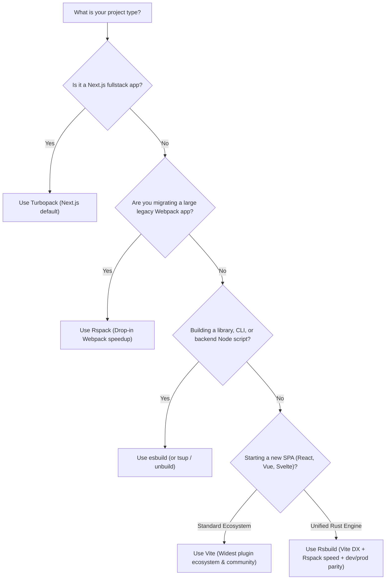

# Modern JavaScript Bundlers Comparison

A hands-on, multi-project benchmark and architectural comparison suite evaluating 7 JavaScript bundlers, build tools, and task runners: **Vite**, **esbuild**, **Rspack**, **Rsbuild**, **Turbopack**, **Webpack**, and a legacy **Gulp** pipeline.

Each bundler has a dedicated, self-contained subproject implementing the exact same benchmark application (React state, HMR, CSS styling, dynamic chunk loading, and heavy component rendering) so you can compare their developer experience, configuration complexity, and production output side-by-side.

---

## 📂 Project Structure

```text
bundlers-comparison/
├── vite/                  # Vite 6 (Native ESM + esbuild dev / Rollup prod)
│   ├── src/               # Shared React application
│   ├── vite.config.mjs    # Vite configuration
│   ├── index.html         # HTML entry point
│   ├── package.json       # Standalone package definition
│   └── README.md
├── esbuild/               # esbuild (Ultra-fast Go compiler & bundler)
│   ├── src/               # Shared React application
│   ├── build.mjs          # Programmatic production build script
│   ├── serve.mjs          # Development server with context API
│   ├── index.html         # HTML entry point
│   ├── package.json       # Standalone package definition
│   └── README.md
├── rspack/                # Rspack 1.x (Rust-based high-performance Webpack successor)
│   ├── src/               # Shared React application
│   ├── rspack.config.mjs  # Webpack-compatible Rspack configuration
│   ├── index.html         # HTML template
│   ├── package.json       # Standalone package definition
│   └── README.md
├── rsbuild/               # Rsbuild 1.x (Zero-config Rspack build tool / Vite alternative)
│   ├── src/               # Shared React application
│   ├── rsbuild.config.mjs # High-level configuration
│   ├── package.json       # Standalone package definition
│   └── README.md
├── turbopack/             # Turbopack (Vercel Rust incremental engine in Next.js)
│   ├── app/               # Next.js App Router implementation
│   ├── next.config.mjs    # Turbopack & Next configuration
│   ├── package.json       # Standalone package definition
│   └── README.md
├── webpack/               # Webpack 5 (The battle-tested industry standard)
│   ├── src/               # Shared React application
│   ├── webpack.config.mjs # Full Webpack 5 + Babel + CSS Extract configuration
│   ├── index.html         # HTML template
│   ├── package.json       # Standalone package definition
│   └── README.md
├── gulp/                  # Gulp 5 (Legacy streaming asset pipeline & task runner)
│   ├── src/               # Shared React application
│   ├── gulpfile.mjs       # Streaming tasks (clean, styles, scripts, html, serve)
│   ├── index.html         # HTML entry point
│   ├── package.json       # Standalone package definition
│   └── README.md
├── scripts/
│   ├── benchmark.mjs      # Automated build performance benchmark runner
│   ├── generate-modules.mjs # Synthetic module generator for stress-testing
│   └── generate-report.mjs  # Generates interactive dashboard.html
├── dashboard.html         # Standalone HTML dashboard with architectural comparisons
└── package.json           # Root workspace orchestrator
```

---

## ⚡ Quick Reference: Port Allocations

| Bundler | Dev Server Command | Port | Key Characteristic |
| :--- | :--- | :---: | :--- |
| **Vite** | `npm run dev:vite` | `http://localhost:3001` | Instant cold start with unbundled ESM |
| **esbuild** | `npm run dev:esbuild` | `http://localhost:3002` | Compiled Go executable, sub-millisecond builds |
| **Rspack** | `npm run dev:rspack` | `http://localhost:3003` | 5x-10x faster Webpack drop-in replacement in Rust |
| **Rsbuild** | `npm run dev:rsbuild` | `http://localhost:3004` | Best-of-both: Vite-like DX with Rspack speed |
| **Turbopack** | `npm run dev:turbopack` | `http://localhost:3005` | Rust incremental computation engine via Next.js |
| **Webpack 5** | `npm run dev:webpack` | `http://localhost:3006` | Industry baseline, maximum plugin extensibility |
| **Gulp (Legacy)** | `npm run dev:gulp` | `http://localhost:3007` | Streaming task runner with file watchers & pipe transforms |

---

## 🚀 Getting Started

### 1. Install Dependencies
You can install dependencies for all workspaces at once from the root:
```bash
npm run install:all
```
*Or navigate to any individual folder (e.g. `cd vite && npm install`).*

### 2. Run Individual Dev Servers
```bash
# Vite
npm run dev:vite

# esbuild
npm run dev:esbuild

# Rspack
npm run dev:rspack

# Rsbuild
npm run dev:rsbuild

# Turbopack
npm run dev:turbopack

# Webpack
npm run dev:webpack

# Gulp (Legacy)
npm run dev:gulp
```

### 3. Run Production Builds
```bash
# Build all bundlers at once
npm run build:all

# Or build individual bundlers
npm run build:vite
npm run build:esbuild
npm run build:rspack
npm run build:rsbuild
npm run build:turbopack
npm run build:webpack
npm run build:gulp
```

### 4. Run the Automated Benchmark Suite
Execute the automated benchmark across installed bundlers:
```bash
npm run benchmark
```
This measures:
- **Cold Build Time**: Clean build from scratch.
- **Warm Build Time**: Re-running build immediately to test cache speed.
- **Output Bundle Size**: Total uncompressed disk footprint in `dist/`.
- **Gzip Size**: Compressed transfer size.
- **Chunk Count**: Number of JavaScript and CSS assets produced.

Results are printed in a terminal comparison table and exported to `BENCHMARK_RESULTS.md`.

### 5. Stress Testing (Synthetic Modules)
Want to benchmark 500 or 1,000 modules?
```bash
npm run generate:modules 500
```
This automatically populates `src/generated/` across all bundlers with synthetic math/logic modules to test bundling throughput under heavy graphs.

---

## 📊 Comprehensive Architectural Comparison Matrix

| Feature / Dimension | Vite | esbuild | Rspack | Rsbuild | Turbopack | Webpack 5 | Gulp (Legacy) |
| :--- | :--- | :--- | :--- | :--- | :--- | :--- | :--- |
| **Language** | TypeScript / Go | Go (Native) | Rust / C++ | Rust + TS | Rust (SWC) | JavaScript (Node.js) | JavaScript (Streams) |
| **Dev Server Approach** | Unbundled Native ESM | Bundled (Go Context) | Bundled in Rust | Bundled in Rust | Incremental AST Cache | Bundled in JS Memory | Static Server + File Watcher |
| **Production Engine** | Rollup (Rolldown in dev) | esbuild native | Rspack native | Rspack native | Turbopack native | Webpack 5 | Node Streams / Tasks |
| **Cold Start Speed** | ⚡⚡⚡ Instant (<300ms) | ⚡⚡⚡ Instant (<50ms) | ⚡⚡ Very Fast (<500ms) | ⚡⚡ Very Fast (<500ms) | ⚡⚡ Very Fast (<600ms) | 🐢 Slow (2-10s+) | Fast (<200ms) |
| **HMR Latency** | ⚡ Sub-millisecond | ⚠️ No native HMR | ⚡ Sub-10ms | ⚡ Sub-10ms | ⚡ Sub-10ms | ⚠️ 50ms - 1s+ | ❌ No HMR (Full Reload) |
| **Config Complexity** | Low (Sensible defaults) | Minimal (Flags/API) | Moderate (Webpack schema) | Low (Zero-config presets) | Minimal (Next.js config) | High (Complex schema) | Moderate (Imperative Code) |
| **Webpack Compatibility** | None (different model) | None | **High (90%+ drop-in)** | **High (via Rspack)** | Partial (subset of loaders) | **Native Standard** | Incompatible (pre-bundler) |
| **CSS Support** | Built-in + PostCSS | Basic built-in | Built-in Rust CSS parser | Built-in + CSS Modules | Built-in + CSS Modules | Requires loaders | Stream transforms (clean-css) |
| **Code Splitting** | Dynamic `import()` | ESM splitting only | Full chunk splitting | Full chunk splitting | Full chunk splitting | Full chunk splitting | Manual stream targets |
| **Module Federation** | Via plugin (`@originjs`) | Not supported | **First-class native** | **First-class plugin** | In progress | **Original Pioneer** | Not supported |
| **SSR Integration** | SSR API / Nuxt / SvelteKit | Custom Node wrapper | Supported | Supported | Built-in (Next.js) | Supported | Custom scripts |

---

## 🔍 In-Depth Tool Profiles

### 1. Vite (`/vite`)
- **How it works**: In development, Vite skips bundling entirely and serves files as native ES modules directly to the browser. As your code imports files, the browser requests them on demand, and Vite transforms them using esbuild. In production, Vite uses Rollup for tree-shaking and chunking.
- **Pros**: Instant dev server start regardless of project size; huge plugin ecosystem; standard choice for modern SPAs.
- **Cons**: Dev/prod environment mismatch (esbuild in dev vs Rollup in prod); large dependency waterfalls in browsers if thousands of raw modules are imported without bundling.

### 2. esbuild (`/esbuild`)
- **How it works**: Evan Wallace wrote esbuild in Go with extreme parallelism and custom lexers/parsers that bypass Vercel/Node.js VM memory overhead. It compiles directly to native machine code.
- **Pros**: Up to 100x faster than Webpack; minimal memory overhead; zero dependency installation.
- **Cons**: Not designed as a full-featured application build tool; lacks built-in HMR dev server; limited code-splitting support for non-ESM targets; intentionally restrictive plugin API.

### 3. Rspack (`/rspack`)
- **How it works**: Developed by ByteDance in Rust, Rspack reproduces Webpack’s architecture and lifecycle hooks while running at native Rust speed with parallelized compilation and integrated SWC parsing.
- **Pros**: Near drop-in replacement for existing Webpack configurations; 5x-10x speed boost; native support for Module Federation; supports most popular Webpack loaders/plugins.
- **Cons**: Still carries some of the configuration overhead of Webpack; Node.js loaders can introduce FFI serialization overhead.

### 4. Rsbuild (`/rsbuild`)
- **How it works**: Built by the ByteDance team on top of Rspack, Rsbuild provides a modern, zero-config layer similar to Vite or Create React App, but powered by the Rspack Rust engine for both dev and production.
- **Pros**: Unified Rust engine in dev and prod (no mismatch); out-of-the-box support for TypeScript, React/Vue/Svelte, CSS Modules, Tailwind, and assets; much cleaner config than raw Rspack.
- **Cons**: Younger ecosystem and community than Vite.

### 5. Turbopack (`/turbopack`)
- **How it works**: Created by Tobias Koppers (Webpack creator) and the Next.js team at Vercel. Built on the "Turbo engine", an incremental computation engine written in Rust that caches work at the function level. It never re-executes calculations already performed.
- **Pros**: Infinite caching capabilities; native first-class integration with React Server Components (RSC) and Next.js App Router; blistering fast HMR.
- **Cons**: Currently integrated into Next.js (`next dev --turbopack`); standalone CLI usage for arbitrary non-Next.js apps is still evolving.

### 6. Webpack 5 (`/webpack`)
- **How it works**: The original pioneer of JavaScript module bundling. Builds a complete in-memory graph of all dependencies before serving or emitting bundles.
- **Pros**: Incomparable maturity, documentation, StackOverflow answers, and plugin availability; handles the most exotic enterprise build scenarios and legacy formats.
- **Cons**: Slowest build and HMR times; high memory footprint on large codebases; notoriously steep configuration learning curve.

### 7. Gulp (`/gulp` - Legacy Baseline)
- **How it works**: A streaming task runner based on Node.js streams and Vinyl virtual file objects. Instead of building an AST dependency graph, it moves files from `gulp.src()` through a sequence of `.pipe()` transformation streams (minification, concatenation, compilation) and writes them to `gulp.dest()`.
- **Pros**: Code-over-configuration; explicit control over sequential or parallel pipelines; ideal for asset-only or multi-page legacy pipelines where no bundler graph is desired.
- **Cons**: Lacks awareness of modern JavaScript module graphs (no native tree shaking or automatic chunk splitting); requires manual concatenation order and full-browser refresh instead of HMR.

---

## 🎯 Which One Should You Choose?



---

## 🖥️ Interactive Visual Dashboard

Open `dashboard.html` in your web browser or preview it locally:
```bash
# Generate/refresh the dashboard
npm run report

# Open in browser (Linux)
xdg-open dashboard.html
# Or on macOS
# open dashboard.html
```
